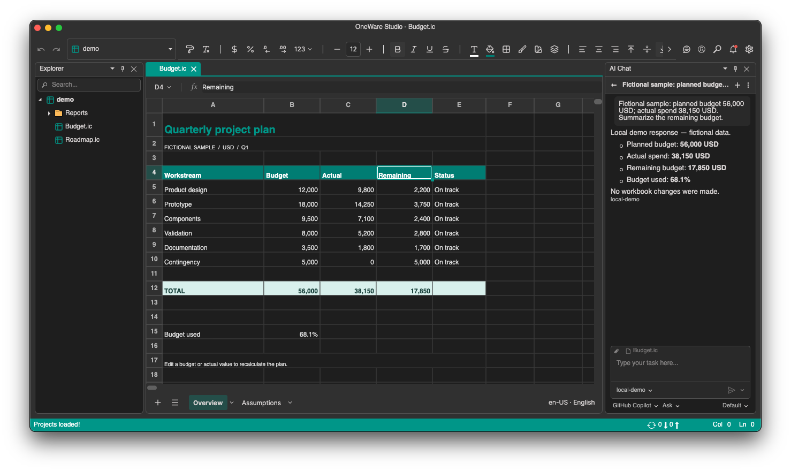
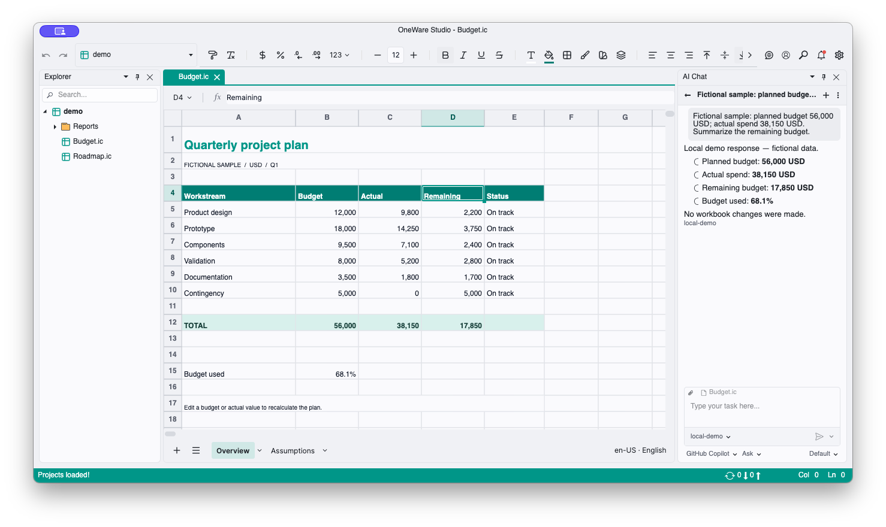

# CyanCalc for OneWare

An experimental spreadsheet editor plugin for [OneWare Studio](https://github.com/one-ware/OneWare),
powered by [CyanCalc](https://github.com/spnvt63995/CyanCalc) and [IronCalc](https://github.com/ironcalc/IronCalc).

**Independent and unofficial.** This project is not endorsed by ONE WARE or IronCalc.
It is an early source preview, not a production-ready spreadsheet application.
Use copies of your workbooks; docking, focus, platform support and file compatibility are still being tested.

## Preview

The same fictional planning workbook in dark and light themes: Explorer on the left,
CyanCalc in the centre, and OneWare's AI Chat on the right.
AI Chat is a host feature. The screenshots show a fixed response from a local test server,
using fictional values supplied in the prompt. This plugin does not provide an AI service
or workbook-editing chat tools.

### Dark



### Light



## What it adds

- `.ic` and `.xlsx` workbook documents with multiple worksheets.
- `.wbproj` projects containing several workbook files, using OneWare's Explorer and document tabs.
- A contextual spreadsheet toolbar, a Workbook menu, and host Undo/Redo integration.
- Existing CyanCalc formatting panels, names, conditional formatting, links, and workbook themes.
- Workbook-to-XLSX and selection-to-PNG export, with document-owned feedback.

Calculation, workbook formats and workbook history come from IronCalc through CyanCalc.
The standalone CyanCalc desktop application is not included.

## Build from source

Install Git, Python 3, the .NET 10 SDK and Rust/Cargo with the native linker for your platform.
Run from this repository's root:

```sh
python3 tools/fetch-dependencies.py
dotnet build OneWare.CyanCalc.slnx -c Release
python3 tools/package.py --output artifacts/OneWare.CyanCalc
```

The bootstrap downloads the exact **public** revisions in [dependencies.json](dependencies.json)
into ignored `.deps/` folders. It refuses to reset existing or modified checkouts.
The source dependencies are public, and the standalone CyanCalc application does not need to be installed.
The current host baseline is **OneWare Studio 1.0.45 / Avalonia 11.3.22**.

## Try the sample

Launch your installed OneWare Studio executable with the staged plugin and separate evaluation directories:

```sh
/path/to/OneWareStudio --modules "$PWD/artifacts/OneWare.CyanCalc" \
  --oneware-dir "$PWD/.local/evaluation/documents" \
  --oneware-appdata-dir "$PWD/.local/evaluation/appdata" \
  "$PWD/examples/QuarterlyPlan/QuarterlyPlan.wbproj"
```

Replace `/path/to/OneWareStudio` with your actual executable. On macOS it is inside the installed `.app` bundle.
You can also open the sample through **File → Open → Workbook project…**.
Choose the project in the host's project selector to activate its contextual toolbar.
All sample data is fictional. The source generator is included under `tools/SampleWorkbook`.

## Development and limitations

- [Building, checks and dependency updates](docs/Development.md)
- [Workbook projects and commands](docs/Usage.md)
- [Integration architecture](docs/Architecture.md)
- [Feedback and validation display](docs/Feedback.md)
- [Known limitations](docs/KnownLimitations.md)
- [Third-party sources and notices](docs/ThirdParty.md)

macOS Apple Silicon is the current development and screenshot platform.
Windows and Linux still need end-to-end GUI validation. Automated checks use a controlled headless host,
not a substitute for native docking and keyboard testing.

## License and attribution

The plugin integration is licensed under [Apache-2.0](LICENSE); see [NOTICE](NOTICE).
CyanCalc, IronCalc, Avalonia, fonts and icons retain their own licenses and notices.
Their license texts are included with the staged runtime package.

Bug reports and contributions are welcome; see [CONTRIBUTING.md](CONTRIBUTING.md).
